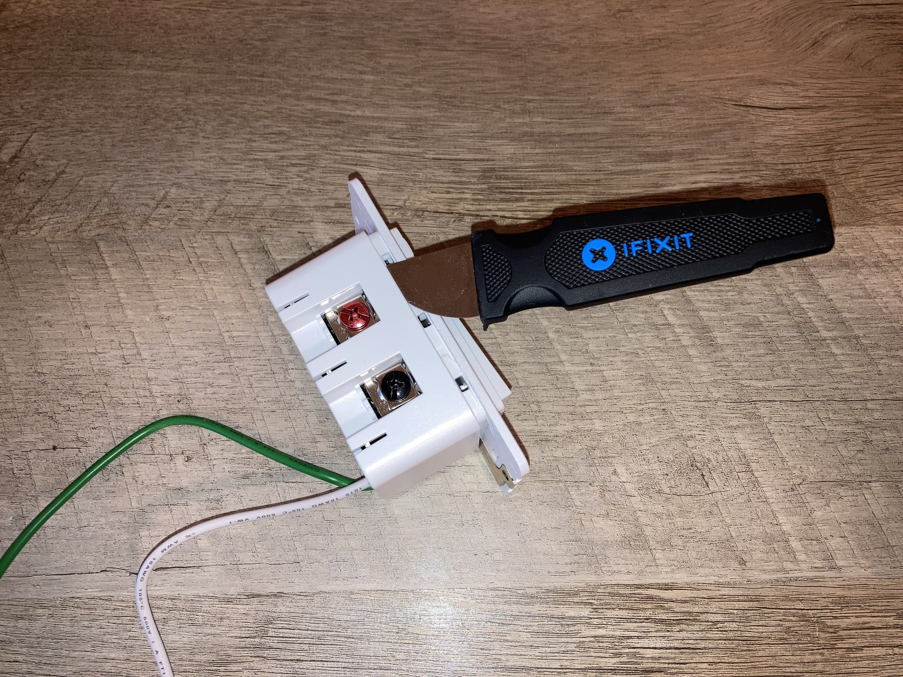
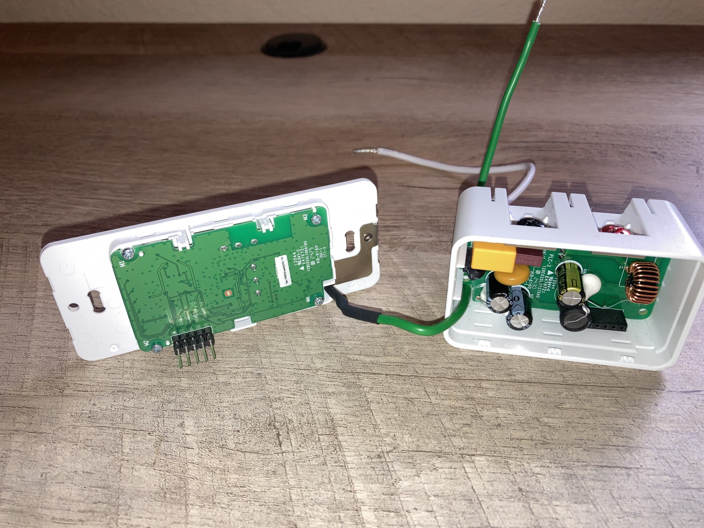
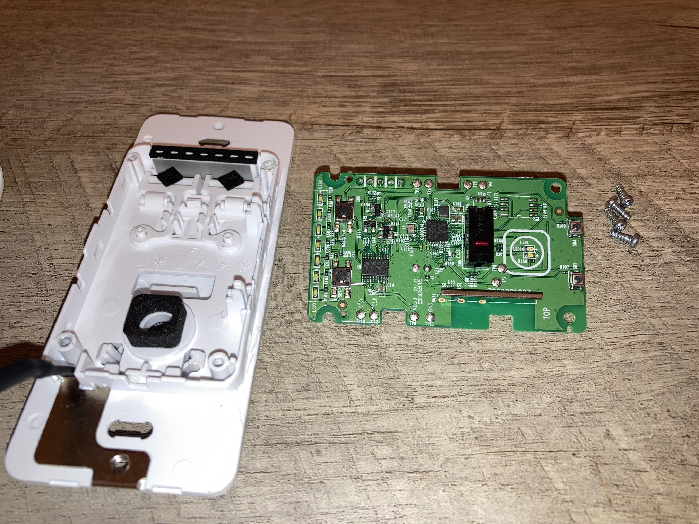
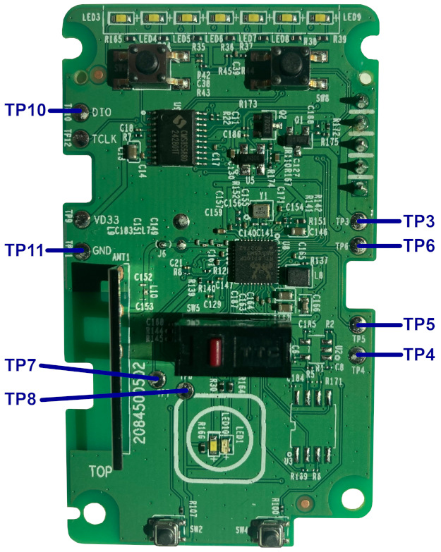
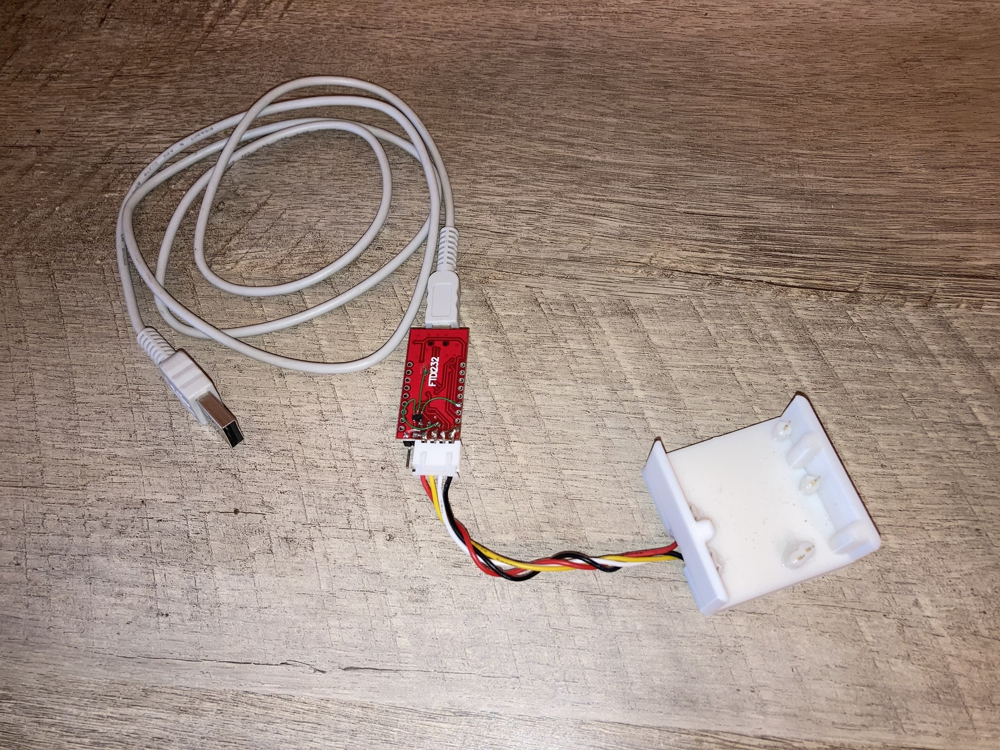
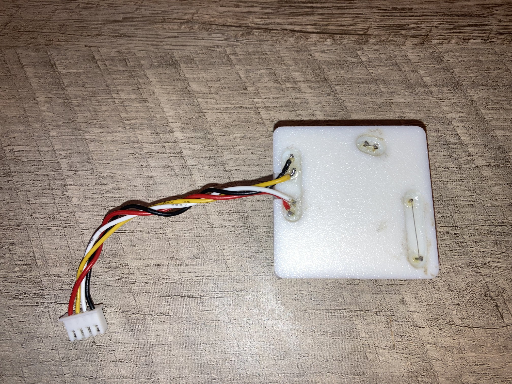
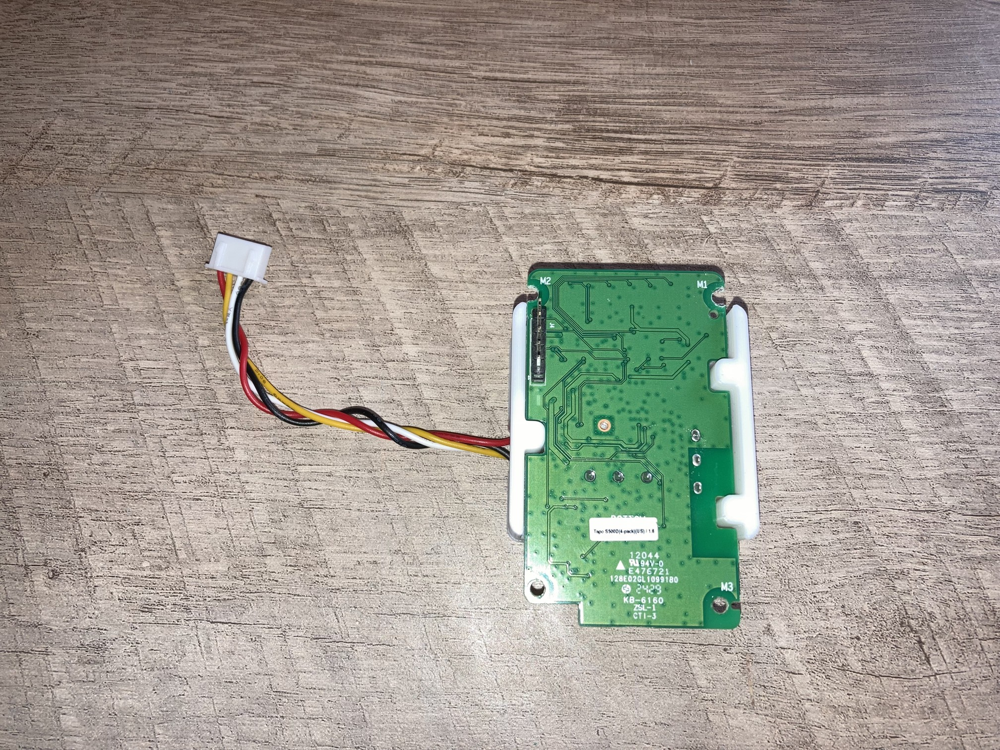

# Overview
The TP-Link Tapo S500D PCB contains a number of exposed solder pads to facilitate programming and testing during manufacturing.  These same pads can be used to reprogram the RTL8710CF on the board with alternative firmware.  
**NOTE:** All information provided here is based on the S500D v1.6

# Accessing the PCB
The TP-Link Tapo S500D is enclosed in a plastic case.  The enclosure is held together via six clips molded into the case; three on each side.  These clips are **tight**, so getting the enclosure open is difficult.  I used a strong metal spsudger to pop one clip and then slid the spudger along the remaining edge to pop the other two open.  Once one side is loose, the other side is fairly easy to pop open.  Be careful with the spudger, it has a tendeancy to slip, creating a hazard for flesh.  Once the plastic enclosure is open, the PCB with the microcontrollers is held to the front of the switch with four small phillips screws.  Remove these four screws to get access to the PCB.

| Clips | Open | PCB |
| - | - | - |
|  |  |  |

# Programming the PCB
Initial programming of the RTL8710CF is done via an external 3.3V UART, after which time it should be able to be reprogrammed over-the-air (OTA).  There are a small number of connections that need to be made, as shown in the diagram below

   
- TP3: Power supply input (connect to 5V or 3.3V)
  - **NOTE:** This is regulated to 3.3V via an on-board LDO.  The UART signals will operate at 3.3V because of this.  Empirical testing shows that connecting this to a 3.3V supply seems to work fine, even though the LDO will reduce the voltage below 3.3V
- TP6: UART receiver input (3.3V signaling)
- TP5: UART transmit output (3.3V signaling)
- TP4: Ground
- TP10: Connect to TP11
- TP7: Connect to TP8

For reference, here are a few notes on why certain connections are made:
    - The CMS8S5880's DIO (TP10) signal is connected to ground (TP11).  This causes the CMS8S5880 microcontroller to not boot, which causes its UART transmit signal to be in a high impedance state.  There is an external pullup on this signal on the TP-Link Tapo S500D design, so the UART receiver on the RTL8710CF will sample this signal as high when it comes out of reset.  This signal on the RTL8710CF UART's receiver must be high in order to allow code to be downloaded via the debug UART
    - The RTL8710CF's GPIOA_0 (TP7) signal is connected to 3.3V (TP8).  This is required for the RTL8710CF to enter into bootloader mode in order to allow code to be downloaded via the debug UART

# Programming Jig
If a large number of TP-Link Tapo S500D devices are being converted, it can be quite cumbersome to solder/desolder all of the connections that are mentioned in the preceeding section for each device.  For this reason, a programming jig was designed and 3D printed.  The jig requires the installation of 8 pogo pins to create a simple "bed-of-nails" programming device.  Once the pogo pins are installed and the connections are made on the bottom side of the jig, a board can then simply be held down in the jig for programming, without the need for any soldering.

The programming jig can be built using the following steps:
- Purchase 0.68mm diameter, 2.65mm stroke pogo pins ([100Pcs P50 B1 0.68mm Round Pogo Pin Spring Test Probes for PCB Testing](https://www.amazon.com/dp/B0D3HW2N59))
- 3D print the "TP-Link Tapo S500D Programmer Jig.stl" (Sketchup Make 2017 model is provided if modifications are desired)
- Install 8 pogo pins into the jig and secure them in place from the top side using epoxy, being careful not to get any epoxy on the movable part
- Solder a jumper wire between the two pogo pins that will make contact with TP10 and TP11
- Solder a jumper wire between the two pogo pins that will make contact with TP7 and TP8
- Solder an external UART to the UART and board power interface provided by TP3, TP4, TP5, and TP6

| Full | Back | Usage |
| - | - | - |
|  |  |  |

**NOTE:** The relationship between the wire colors and the signals in the photos are:
- Black: Ground
- Yellow: UART receiver input (relative to RTL8710CF)
- White: UART transmit output (relative to RTL8710CF)
- Red: 3.3V supply
